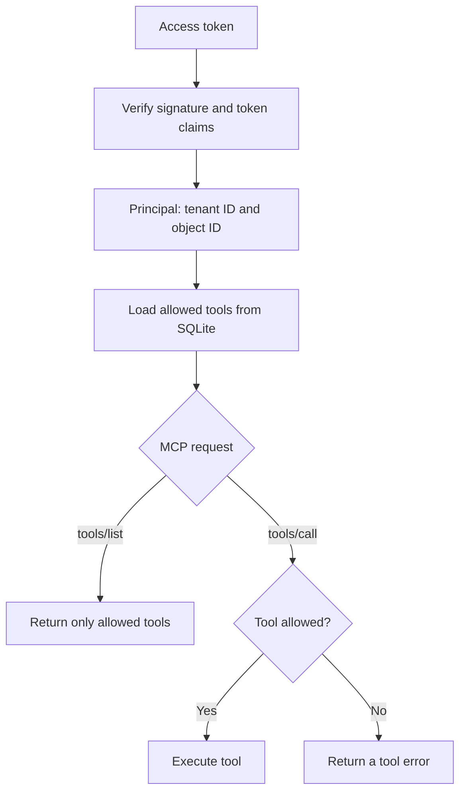

# Part 2: Create Identity Protected MCP Tools

[In Part 1](https://github.com/jgeorg11/oauth_http_mcp/tree/01-harden-auth),
you added automatic signing-key refresh to the Entra-protected Rust MCP server.
In this guide, you will use the authenticated user's identity to decide which
tools they can discover and call.

## What you will build

1. **Store permissions:** map Entra users to database roles and roles to tools.
2. **Keep the verified identity:** return a `Principal` from token validation
   and attach it to each HTTP request.
3. **Enforce access:** filter `tools/list` and check permissions again before
   executing `tools/call`.
4. **Add write tools:** let a `worker` create, update, and delete projects while
   a `reporter` only has access to the three read tools.
5. **Demonstrate the result:** switch accounts and revoke a role to verify
   that the server uses the current identity and permissions.

## How authentication fits together

1. **Identify a user using their stable ID.** Keep the verified token’s `tid` (tenant ID) and `oid` (user object ID). Use those for permission lookups. Microsoft advises against authorizing by username or email because those values can change. [Claims reference](https://learn.microsoft.com/en-us/entra/identity-platform/access-token-claims-reference)

2. **Decide where permissions live.** Two straightforward options:
   - **Entra app roles:** Define roles such as `Projects.Reader` and `Projects.Admin` on the MCP server’s **API registration**, then assign a user through its Enterprise application. Entra includes the assigned roles in access tokens issued for that API. [App-role setup](https://learn.microsoft.com/en-us/entra/identity-platform/howto-add-app-roles-in-apps)
   - **Your database:** Look up permissions using a user’s verified `(tid, oid)`. This lets your application manage access without putting every permission into Entra.

For example, an Entra app-role setup could use these permissions:

| Tool | Required role | John has `Projects.Reader` |
|---|---|---|
| `get_projects` | `Projects.Reader` | Allowed |
| `get_project_by_id` | `Projects.Reader` | Allowed |
| `get_project_by_query` | `Projects.Reader` | Allowed |
| A future `delete_project` | `Projects.Admin` | Denied |

For this guide, we will use the database approach with roles named `reporter`
and `worker`. Both can read projects; only `worker` can write them. These roles
are stored in SQLite and do not require Entra app-role assignments.

Authentication verifies the token, and authorization
uses its verified identity to look up allowed tools on each request:



## Before you start

1. **Complete Part 1.** Keep its Entra API and OAuth client registrations,
   delegated `access_as_user` scope, token validation, and JWKS refresh logic.
2. **Use your existing local configuration.** Confirm `.env` contains your
   `ENTRA_TENANT_ID` and `ENTRA_API_CLIENT_ID`, with
   `MCP_RESOURCE=http://localhost:8001/mcp` and
   `DATABASE_URL=sqlite://data/demo.db`. For a fresh checkout, copy
   `.env.example` to `.env` and fill in your IDs. The
   [plugin setup guide](plugin/README.md) covers client configuration and
   installation.
3. **Have two Entra accounts available.** This walkthrough uses John as a
   `worker` and Jane as a `reporter` in the configured tenant. Record the
   tenant ID and each user's Object ID from Entra.
4. **Run commands from the repository root.** You will need the Rust toolchain
   from Part 1 and the `sqlite3` CLI. Stop the running server while editing.
   The code below explains the changes from Part 1; this checkout already
   contains the completed implementations.
5. **Prepare the demo database.** Keep your existing Part 1 database. If you
   need a fresh demo database, run:

   ```sh
   mkdir -p data
   sqlite3 data/demo.db < data/seed.sql
   ```

   The seed script inserts five fictional projects and resets matching IDs to
   their seed values. Run it only when you want that demo data.

## 1. Add the Permissions Tables and Roles

First, map each user's `(tenant_id, object_id)` to a role, then map each role
to its allowed tools. In [data/authorization.sql](data/authorization.sql),
create the tables and tool grants:

```sql
CREATE TABLE IF NOT EXISTS user_roles (
    tenant_id TEXT NOT NULL,
    object_id TEXT NOT NULL,
    role TEXT NOT NULL,
    PRIMARY KEY (tenant_id, object_id, role)
);

CREATE TABLE IF NOT EXISTS role_tools (
    role TEXT NOT NULL,
    tool_name TEXT NOT NULL,
    PRIMARY KEY (role, tool_name)
);

INSERT OR IGNORE INTO role_tools (role, tool_name) VALUES
    ('reporter', 'get_project_by_id'),
    ('reporter', 'get_project_by_query'),
    ('reporter', 'get_projects'),
    ('worker', 'get_project_by_id'),
    ('worker', 'get_project_by_query'),
    ('worker', 'get_projects'),
    ('worker', 'create_project'),
    ('worker', 'update_project'),
    ('worker', 'delete_project');
```

Apply the SQL to the demo database:

```sh
sqlite3 data/demo.db < data/authorization.sql
```

The script also includes placeholder user assignments. They do not grant
access to real accounts. To assign your demonstration users, open the database:

```sh
sqlite3 data/demo.db
```

Replace the placeholders below with the tenant ID and each account's **Object
ID**, then execute the SQL in that SQLite session:

```sql
INSERT OR IGNORE INTO user_roles (tenant_id, object_id, role)
VALUES
    ('YOUR_TENANT_ID', 'JOHN_OBJECT_ID', 'worker'),
    ('YOUR_TENANT_ID', 'JANE_OBJECT_ID', 'reporter');
```

Confirm the assignments, then leave SQLite:

```sql
SELECT tenant_id, object_id, role FROM user_roles;
.quit
```

John now has all six tools through `worker`; Jane has the three read tools
through `reporter`. A user without an assignment has no tool permissions.

## 2. Return a verified principal from validation

Next, we need to extend `Claims` and add `Principal` to return a verified principal from the token validation. This will allow us to use the principal in our permission checks.

In [src/auth.rs](src/auth.rs), add `oid` to `Claims` and define `Principal`:

```diff
 #[derive(Deserialize)]
 struct Claims {
     tid: String,
+    oid: String,
     ver: String,
     #[serde(default)]
     scp: String,
 }

+#[derive(Clone, Debug)]
+pub struct Principal {
+    pub tenant_id: String,
+    pub object_id: String,
+}
```

Update `AuthState::validate` to return `Result<Principal, StatusCode>` instead
of `Result<(), StatusCode>`. Keep the existing signature and claim validation
in `verify_token_with_cache`; build the principal only after validation succeeds:

```rust
async fn validate(&self, token: &str) -> Result<Principal, StatusCode> {
    let claims = self.verify_token_with_cache(token).await?;

    if claims.tid != self.config.tenant_id
        || claims.ver != "2.0"
        || claims.oid.trim().is_empty()
    {
        return Err(StatusCode::UNAUTHORIZED);
    }

    if !claims
        .scp
        .split_ascii_whitespace()
        .any(|s| s == "access_as_user")
    {
        return Err(StatusCode::FORBIDDEN);
    }

    Ok(Principal {
        tenant_id: claims.tid,
        object_id: claims.oid,
    })
}
```

Next, make the `request` parameter in `require_auth` mutable so the middleware
can attach the principal to its HTTP request extensions:

```diff
 pub async fn require_auth(
     State(auth): State<Arc<AuthState>>,
-    request: Request,
+    mut request: Request,
     next: Next,
 ) -> Response {
```

Keep the existing bearer-token extraction and `Response` return type. Replace
the final `match` with:

```rust
match auth.validate(token).await {
    Ok(principal) => {
        request.extensions_mut().insert(principal);
        next.run(request).await
    }
    Err(StatusCode::FORBIDDEN) => {
        auth.reject(StatusCode::FORBIDDEN, Some("insufficient_scope"))
    }
    Err(_) => {
        auth.reject(StatusCode::UNAUTHORIZED, Some("invalid_token"))
    }
}
```

### Add the Application Permissions Lookup

> This lookup is specific to the database approach. With Entra app roles,
> replace it with a lookup based on verified role claims before continuing.

Create [src/authz.rs](src/authz.rs):

```rust
use std::collections::HashSet;

use sqlx::SqlitePool;

use crate::auth::Principal;

pub struct ToolPermissions {
    tools: HashSet<String>,
}

impl ToolPermissions {
    pub fn can_use(&self, tool_name: &str) -> bool {
        self.tools.contains(tool_name)
    }
}

pub async fn load_tool_permissions(
    pool: &SqlitePool,
    principal: &Principal,
) -> Result<ToolPermissions, sqlx::Error> {
    let tools = sqlx::query_scalar::<_, String>(
        "SELECT DISTINCT rt.tool_name
         FROM user_roles AS ur
         JOIN role_tools AS rt ON rt.role = ur.role
         WHERE ur.tenant_id = ? AND ur.object_id = ?",
    )
    .bind(&principal.tenant_id)
    .bind(&principal.object_id)
    .fetch_all(pool)
    .await?;

    Ok(ToolPermissions {
        tools: tools.into_iter().collect(),
    })
}
```

Register the new module in [src/main.rs](src/main.rs):

```diff
 mod auth;
+mod authz;
 mod config;
```

The lookup joins all roles assigned to the verified `(tid, oid)` and returns
their combined tool permissions. Calling it on each request lets a role
change take effect without restarting the server.

## 3. Add the Discovery Filter and Execution Guard

Now connect the verified principal to the MCP handlers in
[src/mcp.rs](src/mcp.rs). Apply the following changes to the Part 1 server.
First, add the imports, retrieve the principal from the current HTTP request,
and load its permissions:

```diff
-use rmcp::{ServerHandler, tool_handler};
+use rmcp::{
+    ErrorData, RoleServer, ServerHandler,
+    handler::server::tool::ToolCallContext,
+    model::{
+        CacheScope, CallToolRequestParams, CallToolResponse, CallToolResult, ContentBlock,
+        ListToolsResult, PaginatedRequestParams, ProtocolVersion,
+    },
+    service::RequestContext,
+    tool_handler,
+};
 use sqlx::SqlitePool;

+use crate::{
+    auth::Principal,
+    authz::{ToolPermissions, load_tool_permissions},
+};
 #[derive(Clone)]
 pub struct McpServer {
     pub(crate) pool: SqlitePool,
 }

+fn principal_from_context(context: &RequestContext<RoleServer>) -> Result<Principal, ErrorData> {
+    context
+        .extensions
+        .get::<axum::http::request::Parts>()
+        .and_then(|parts| parts.extensions.get::<Principal>())
+        .cloned()
+        .ok_or_else(|| ErrorData::internal_error("Authenticated identity is missing", None))
+}
+
 impl McpServer {
     pub fn new(pool: SqlitePool) -> Self {
         Self { pool }
     }
+
+    async fn permissions_for_request(
+        &self,
+        context: &RequestContext<RoleServer>,
+    ) -> Result<(Principal, ToolPermissions), ErrorData> {
+        let principal = principal_from_context(context)?;
+
+        let permissions = load_tool_permissions(&self.pool, &principal)
+            .await
+            .map_err(|error| {
+                tracing::error!(
+                    %error,
+                    tenant_id = %principal.tenant_id,
+                    object_id = %principal.object_id,
+                    "Tool permission lookup failed"
+                );
+                ErrorData::internal_error("Unable to check tool permissions", None)
+            })?;
+        Ok((principal, permissions))
+    }
 }
```

Retrieve the identity from each request's extensions rather than storing it
on `McpServer` or in the MCP session. If the identity is missing or the
permission lookup fails, return an error before any tool runs.

Next, replace the empty `ServerHandler` implementation with the discovery
filter and execution guard:

```diff
 // Registers the router generated by #[tool_router] in tools.rs.
 #[tool_handler]
-impl ServerHandler for McpServer {}
+impl ServerHandler for McpServer {
+    async fn list_tools(
+        &self,
+        _request: Option<PaginatedRequestParams>,
+        context: RequestContext<RoleServer>,
+    ) -> Result<ListToolsResult, ErrorData> {
+        let (principal, permissions) = self.permissions_for_request(&context).await?;
+
+        let tools = Self::tool_router()
+            .list_all()
+            .into_iter()
+            .filter(|tool| permissions.can_use(tool.name.as_ref()))
+            .collect::<Vec<_>>();
+
+        tracing::info!(
+            tenant_id = %principal.tenant_id,
+            object_id = %principal.object_id,
+            allowed_tools = ?tools.iter().map(|tool| tool.name.as_ref()).collect::<Vec<_>>(),
+            "MCP tool discovery authorized"
+        );
+
+        let mut result = ListToolsResult::with_all_items(tools);
+
+        if context
+            .protocol_version()
+            .is_some_and(|v| v >= ProtocolVersion::V_2026_07_28)
+        {
+            result.ttl_ms = Some(0);
+            result.cache_scope = Some(CacheScope::Private);
+        }
+
+        Ok(result)
+    }
+
+    async fn call_tool(
+        &self,
+        request: CallToolRequestParams,
+        context: RequestContext<RoleServer>,
+    ) -> Result<CallToolResponse, ErrorData> {
+        let (principal, permissions) = self.permissions_for_request(&context).await?;
+
+        if !permissions.can_use(request.name.as_ref()) {
+            tracing::warn!(
+                tenant_id = %principal.tenant_id,
+                object_id = %principal.object_id,
+                tool = %request.name,
+                allowed = false,
+                "MCP tool authorization denied"
+            );
+            return Ok(CallToolResult::error(vec![ContentBlock::text(
+                "You do not have permissions to use this tool.",
+            )])
+            .into());
+        }
+
+        tracing::info!(
+            tenant_id = %principal.tenant_id,
+            object_id = %principal.object_id,
+            tool = %request.name,
+            allowed = true,
+            "MCP tool authorization granted"
+        );
+
+        Self::tool_router()
+            .call(ToolCallContext::new(self, request, context))
+            .await
+    }
+}
```

`tools/list` now returns only permitted tools. For clients using protocol
version `2026-07-28` or later, the response also marks the list private with
a zero cache lifetime. The `tools/call` guard checks permissions independently,
so a cached tool definition or a direct call cannot bypass authorization.

## 4. Add the Protected Tools

The three read tools already exist from Part 1. Add `create_project`,
`update_project`, and `delete_project` so you can demonstrate different access
for the two roles. The permissions added in section 1 already use these exact
tool names.

### Define the tool inputs and results

In [src/models.rs](src/models.rs), import `rmcp::schemars` and add
`schemars::JsonSchema` to `Project`'s existing derives. This lets the tool
results advertise the shape of a project:

```diff
+use rmcp::schemars;
 use serde::{Deserialize, Serialize};
 use sqlx::FromRow;

-#[derive(Debug, Clone, Serialize, Deserialize, FromRow)]
+#[derive(Debug, Clone, Serialize, Deserialize, FromRow, schemars::JsonSchema)]
 pub struct Project {
```

In [src/tools.rs](src/tools.rs), import `Json` alongside `Parameters`,
`Serialize` alongside `Deserialize`, and `models::Project`. Add these input
and result types next to the existing lookup and search arguments:

```rust
#[derive(Debug, Deserialize, schemars::JsonSchema)]
pub struct CreateProject {
    pub name: String,
    pub owner: String,
    pub status: String,
    pub budget: f64,
    pub risk_score: i64,
}

#[derive(Debug, Deserialize, schemars::JsonSchema)]
pub struct UpdateProject {
    pub project_id: i64,
    pub name: Option<String>,
    pub owner: Option<String>,
    pub status: Option<String>,
    pub budget: Option<f64>,
    pub risk_score: Option<i64>,
}

#[derive(Debug, Serialize, schemars::JsonSchema)]
pub struct ProjectsResult {
    pub projects: Vec<Project>,
}

#[derive(Debug, Serialize, schemars::JsonSchema)]
pub struct ProjectResult {
    pub project: Project,
}

#[derive(Debug, Serialize, schemars::JsonSchema)]
pub struct DeleteProjectResult {
    pub deleted: bool,
}
```

Keep the field descriptions shown in the completed source so clients can
explain the inputs. Creation requires all five project fields. Updates
require an ID; omitted or null fields preserve their current values. Reuse
`GetProjectById` for deletion.

### Add the database operations

In [src/storage.rs](src/storage.rs), add the three write functions below the
existing read functions. Use the completed implementations in that file:

| Function | Database operation | Return value |
| --- | --- | --- |
| `create_project` | Insert the supplied fields with bound parameters and `RETURNING *`. SQLite assigns the ID and timestamp. | `Result<Project, sqlx::Error>` |
| `update_project` | Update by ID using `COALESCE(?, column)` to preserve omitted fields, then read the updated row in the same transaction. | `Result<Option<Project>, sqlx::Error>` |
| `delete_project` | Delete by ID using a bound parameter and inspect the affected row count. | `Result<bool, sqlx::Error>` |

No project-table migration is needed: `data/seed.sql` already defines all
the fields. An update or deletion of a missing ID must become a tool error.

### Register the write tools

Add the three methods inside the existing `#[tool_router]` implementation in
[src/tools.rs](src/tools.rs). Each method accepts its typed arguments, calls
the matching storage function, and returns a typed JSON result. For example,
the creation handler is:

```rust
#[tool(
    title = "Create project",
    description = "Create a project in the connected database when the user requests creation and supplies its name, owner, status, budget, and risk score. The database assigns its ID and creation timestamp. Returns {project: {...}}. Each call inserts a new record, so repeating the call creates another project.",
    annotations(
        read_only_hint = false,
        destructive_hint = false,
        idempotent_hint = false,
        open_world_hint = false
    )
)]
pub async fn create_project(
    &self,
    Parameters(args): Parameters<CreateProject>,
) -> Result<Json<ProjectResult>, CallToolResult> {
    match storage::create_project(
        &self.pool,
        &args.name,
        &args.owner,
        &args.status,
        args.budget,
        args.risk_score,
    )
    .await
    {
        Ok(project) => {
            tracing::info!(
                tool = "create_project",
                result_count = 1,
                "MCP tool completed"
            );
            Ok(Json(ProjectResult { project }))
        }
        Err(error) => Err(query_error("create_project", error)),
    }
}
```

Follow it with the `update_project` and `delete_project` handlers in the
completed source. The update handler returns `Json(ProjectResult { project })`;
the delete handler returns `Json(DeleteProjectResult { deleted: true })`.
Both return `CallToolResult::error` for a missing project. Mark them with
`read_only_hint = false`, `destructive_hint = true`, `idempotent_hint = true`,
and `open_world_hint = false` as shown in the source. These annotations
describe behavior to the client; section 3's guard enforces permissions.

Update the existing read handlers to use `Json<ProjectsResult>` for list and
search, and `Json<ProjectResult>` for lookup, each wrapped in
`Result<..., CallToolResult>`. This preserves the `{ "projects": [...] }` and
`{ "project": {...} }` response shapes while adding output schemas. Remove
the old `serde_json::json` import once the handlers no longer use it.

### Build and start the server

Check the completed changes and start the server:

```sh
cargo check --locked
cargo run --locked
```

Leave the server running for section 5. It listens at
`http://localhost:8001/mcp` with the example configuration. Keep using the
Part 1 client connection; if you have not installed it yet, follow
[the plugin installation steps](plugin/README.md#install-in-codex-and-sign-in).
The client discovers the new tools from the server.

## 5. Demonstrate the Protected Tools

Follow these steps to reproduce the permission checks with your own accounts.

1. **Sign in as John.** Use the Part 1 client to sign in with the account
   assigned the `worker` role. The client discovers all six tools.

2. **Call the read tools.** Prompt the client to call `get_projects`, `get_project_by_id`, or
   `get_project_by_query`. Each returns the expected results.

3. **Call the write tools.** Prompt the client to call `create_project`, `update_project`, or
   `delete_project`. Each returns a successful result.

4. **Sign out and sign in as Jane.** Use the Part 1 client to sign in with the
   account assigned the `reporter` role. The client discovers only the three
   read tools.
```bash
codex mcp logout oauth-http-mcp    
codex mcp login oauth-http-mcp
```

5. **Call the read tools.** Prompt the client to call `get_projects`, `get_project_by_id`, or
   `get_project_by_query`. Each returns the expected results.

6. **Call the write tools.** Prompt the client to call `create_project`, `update_project`, or
   `delete_project`. Each returns a tool error indicating the client has no knowledge of the tool or lacks permission to use it.

## Next steps

This guide is part of a four-part series on creating and publishing
a well-architected MCP server.

Previous guides:

- [Part 0: Build an OAuth 2.1-protected HTTP MCP server](https://github.com/jgeorg11/oauth_http_mcp/tree/main).
- [Part 1: Handle Entra signing-key rotation without restarting the MCP server](https://github.com/jgeorg11/oauth_http_mcp/tree/01-harden-auth).

Continue with:

- [Part 3: Create a long-running tool with streamed results](https://github.com/jgeorg11/oauth_http_mcp/tree/03-stream-tool).
