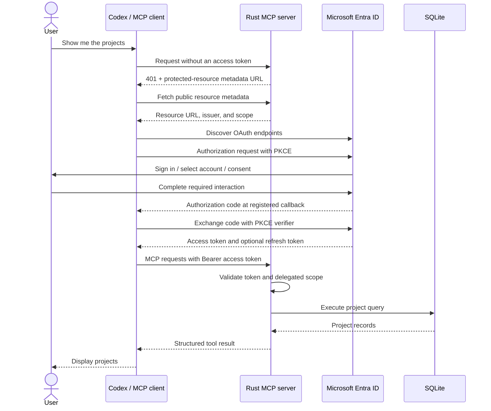

# Build an OAuth 2.1-protected HTTP MCP server

> Replace `YOUR_GITHUB_OWNER/YOUR_REPOSITORY` in repository links and clone
> commands with the location of your public GitHub repository.

This guide provides starter code for an authenticated MCP service.
You will run an MCP server, register an API and a public client in Microsoft
Entra ID, connect Codex over Streamable HTTP, and query a small SQLite project
database after signing in.

The solution follows the [MCP authorization model](https://modelcontextprotocol.io/specification/2025-11-25/basic/authorization):
the client obtains an access token using Authorization Code with PKCE, and the
MCP server validates that token before accepting protected requests. Entra
handles sign-in and token issuance. The Rust application acts as the OAuth
resource server.

This guide builds the local development baseline and provides convenient
template code and structure so it can easily be expanded and adapted for 
your use case. The authentication configuration is designed to easily port
this application to a production hosting environment, not to be continuously
ran from your local machine. 

## What you will build

The server exposes one MCP endpoint at `http://localhost:8001/mcp`. Start
with local development, then adapt the configuration for an HTTPS deployment
such as `https://mcp.example.com/mcp`. The starter code is designed to be
readable and easy to adapt to your own data and tools. The starter code
includes three read-only tools:

| Tool | Arguments | Result |
| --- | --- | --- |
| `get_projects` | `{}` | All projects ordered by ID |
| `get_project_by_id` | `{ "project_id": 1 }` | One project, or a not-found tool error |
| `get_project_by_query` | `{ "query": "AI" }` | Projects with matching names |

Search uses SQLite `LIKE` with a substring pattern; `%` and `_` act as
wildcards. Each project includes its ID, name, owner, status, budget, risk
score, and creation timestamp.

The transport is [Streamable HTTP](https://modelcontextprotocol.io/specification/2025-11-25/basic/transports#streamable-http).
It supports JSON responses and SSE streams through RMCP.

## How authentication fits together



The sign-in interaction is needed when the client has no usable credentials.
Subsequent requests reuse a valid access token, or the client refreshes it
when possible. Restarting the MCP server does not sign the client out.

At startup, the server separately fetches Entra's OpenID discovery document
and public signing keys. Token verification uses those public keys and does
not require a client secret.

## Before you start

- Install Rust and Cargo. The locked dependencies require **Rust 1.94 or
  newer** because this project uses SQLx 0.9.
- Have `sqlite3` and `curl` available in your terminal.
- Have access to an Entra tenant and permission to register applications,
  expose an API, and grant the required consent.
- Install the ChatGPT desktop app and a Codex CLI that supports plugins and
  MCP OAuth. 
- Clone or download the [source repository](https://github.com/YOUR_GITHUB_OWNER/YOUR_REPOSITORY).
  Access to the internal Git host is required.

To clone the repository and enter its root directory:

```bash
git clone https://github.com/YOUR_GITHUB_OWNER/YOUR_REPOSITORY.git oauth_http_mcp
cd oauth_http_mcp
```

Run all commands below from this directory. Create your own Entra app
registrations; the published templates contain placeholders. Steps 3 and 4
create the local configuration files `plugin/.mcp.json` and `.env`. Both files
are ignored by Git. If either file already exists, edit it instead of copying
over it.

## 1. Choose the resource URL and record the application IDs

Keep the default local resource URL for this walkthrough:

```text
http://localhost:8001/mcp
```

You will create **two separate app registrations** in the same Entra tenant:

| Value | Meaning | Where it is used |
| --- | --- | --- |
| Tenant ID | Directory issuing the tokens | `.env`: `ENTRA_TENANT_ID` |
| API application ID | Application (client) ID of the MCP API registration | `.env`: `ENTRA_API_CLIENT_ID`; expected token audience |
| Client application ID | Application (client) ID of the Codex OAuth client registration | `plugin/.mcp.json`: `oauth.clientId` |
| Resource URL | Canonical URL of this MCP service | `.env`: `MCP_RESOURCE`; plugin `url`; API Application ID URI |
| Delegated scope | Permission requested for this API | `http://localhost:8001/mcp/access_as_user` |
| Client callback | Where Entra returns the authorization code | Client app redirect URI; plugin `oauth.callbackUrl` |

The API application ID and the client application ID serve different purposes.
For the v2 tokens accepted here, the expected audience is the API's
application ID GUID, even though the resource URL and scope use the HTTP URL.

Use the exact same resource URL throughout the configuration. In this
starter, `/mcp` is required and `/mcp/` is a different value.

## 2. Register and expose the MCP API in Entra

1. Open **Microsoft Entra admin center → App registrations → New
   registration**. Name the app, for example, **Project Query MCP API**,
   choose the single-tenant account type, and register it.
2. From **Overview**, record the **Directory (tenant) ID** and **Application
   (client) ID**. These become `ENTRA_TENANT_ID` and `ENTRA_API_CLIENT_ID`.
3. In **Manifest**, set `api.requestedAccessTokenVersion` to `2`. Preserve
   the other manifest properties.
4. Under **Expose an API**, set the **Application ID URI** to
   `http://localhost:8001/mcp`. If editing `identifierUris` in the manifest,
   preserve any other values your application still uses.
5. Add and enable a delegated scope named **`access_as_user`**. Supply
   suitable consent labels and descriptions, and choose who may consent
   according to your tenant policy.

The full scope should now be:

```text
http://localhost:8001/mcp/access_as_user
```

Microsoft's [MCP registration guide](https://learn.microsoft.com/en-us/entra/agent-id/secure-mcp-server-with-entra-id)
explains the v2-token and canonical-resource setup. Tenant policies can
restrict Application ID URIs; see [identifier URI restrictions](https://learn.microsoft.com/en-us/entra/identity-platform/identifier-uri-restrictions)
if your local URI is rejected. A tenant that disallows this local setup needs
an approved HTTPS resource URL and corresponding changes to the server and
client configuration.

## 3. Register the OAuth client and configure the plugin

1. Create a second single-tenant registration, for example, **Project Query
   MCP Client**. Record its **Application (client) ID**.
2. Under **Authentication**, add a **Mobile and desktop applications**
   platform and register the callback used by this repository's plugin:

   ```text
   http://localhost:1456/callback/nUXMQeJafTLA
   ```

3. Under **API permissions → Add a permission → My APIs**, select your MCP
   API, choose **Delegated permissions**, and add **`access_as_user`**.
4. Grant admin consent if your tenant or chosen scope requires it.
5. Create the local plugin configuration from the template:

   ```bash
   cp plugin/.mcp.json.example plugin/.mcp.json
   ```

6. Edit `plugin/.mcp.json`, replacing `oauth.clientId` with the client
   registration's application ID:

   ```json
   {
     "mcpServers": {
       "oauth-http-mcp": {
         "type": "http",
         "url": "http://localhost:8001/mcp",
         "scopes": [
           "http://localhost:8001/mcp/access_as_user",
           "offline_access"
         ],
         "oauth": {
           "clientId": "<YOUR_CLIENT_APPLICATION_ID>",
           "callbackUrl": "http://localhost:1456/callback/nUXMQeJafTLA",
           "callbackPort": 1456
         }
       }
     }
   }
   ```

The callback is a **client-side** listener on port `1456`. The MCP API runs
on port `8001`. The callback is not an API route to add to the Rust server.
Keep the registered redirect URI and the callback actually used by your
client identical. The callback suffix in this example is a public identifier
derived from the local MCP URL; it is not a credential. Codex can select a
different callback when the server URL or client behavior changes. Confirm
the `redirect_uri` used during sign-in and update the Entra registration and
local configuration together if it differs. See the
[official OAuth callback guidance](https://learn.chatgpt.com/docs/extend/mcp?surface=cli#oauth-client-registration-and-callbacks).

This desktop client uses [Authorization Code with PKCE](https://learn.microsoft.com/en-us/entra/identity-platform/v2-oauth2-auth-code-flow).
Do not create a client secret for this walkthrough.

The plugin uses the Codex-compatible `type: "http"` configuration shown
above. Its manifest and project-query skill are already included. The
`plugin/README.md` file contains package details.

## 4. Configure and run the MCP server

Create the local server configuration from the environment template:

```bash
cp .env.example .env
```

Edit `.env` to use **your tenant ID and API application ID**:

```dotenv
ENTRA_TENANT_ID=<YOUR_TENANT_ID>
ENTRA_API_CLIENT_ID=<YOUR_API_APPLICATION_ID>
MCP_RESOURCE=http://localhost:8001/mcp
MCP_HOST=127.0.0.1
MCP_PORT=8001
DATABASE_URL=sqlite://data/demo.db
MAX_CONNECTIONS=10
RUST_LOG=info
```

Replace the angle-bracket placeholders with the actual GUIDs. The `.env`
file and `plugin/.mcp.json` are ignored by Git; publish only their `.example`
templates. The API ID here comes from step 2; the client ID in the plugin
comes from step 3. This setup requires no client secret or hard-coded token.

Create the local demo database using `data/seed.sql`. The database file is
ignored by Git and must be generated after cloning. The seed script creates
the projects table and inserts five fictional sample projects. Running it
again resets records with those seed IDs.

```bash
mkdir -p data
sqlite3 data/demo.db < data/seed.sql
cargo check --locked
```

Start the server and leave the terminal running:

```bash
cargo run --locked
```

Expect a log message indicating that the server is listening on
`http://127.0.0.1:8001/mcp`. Connect the client using the configured canonical
resource URL, `http://localhost:8001/mcp`.

Startup requires outbound HTTPS access to Entra for discovery and signing
keys. Invalid configuration or failed discovery stops startup.

| Setting | Purpose | Behavior when omitted |
| --- | --- | --- |
| `ENTRA_TENANT_ID` | Trusted tenant and issuer | Required |
| `ENTRA_API_CLIENT_ID` | Expected v2 access-token audience | Required |
| `MCP_RESOURCE` | Canonical MCP URL used in discovery and scope | Required |
| `MCP_HOST` | Listening interface | `0.0.0.0`; the local example explicitly uses `127.0.0.1` |
| `MCP_PORT` | Listening port | `8001` |
| `DATABASE_URL` | SQLite connection string | `sqlite://data/demo.db` |
| `MAX_CONNECTIONS` | Shared SQLx pool size | `10` |
| `RUST_LOG` | Logging filter | `info` |

## 5. Verify discovery and the authentication boundary

In a second terminal, fetch the public protected-resource metadata:

```bash
curl -i http://localhost:8001/.well-known/oauth-protected-resource/mcp
```

Expect `200 OK` and JSON with your tenant in `authorization_servers`:

```json
{
  "resource": "http://localhost:8001/mcp",
  "authorization_servers": [
    "https://login.microsoftonline.com/<YOUR_TENANT_ID>/v2.0"
  ],
  "scopes_supported": [
    "http://localhost:8001/mcp/access_as_user"
  ],
  "bearer_methods_supported": ["header"]
}
```

Now try the protected endpoint without credentials:

```bash
curl -i http://localhost:8001/mcp
```

Expect `401 Unauthorized` with this challenge; header casing may vary:

```http
WWW-Authenticate: Bearer resource_metadata="http://localhost:8001/.well-known/oauth-protected-resource/mcp", scope="http://localhost:8001/mcp/access_as_user"
```

The public route lets clients discover how to authenticate. The middleware
protects `/mcp` before requests enter RMCP, including requests that carry an
MCP session ID. An MCP session ID does not replace a bearer token.

## 6. Install the Codex plugin and sign in

With the server running and your client ID saved in `plugin/.mcp.json`, run
these commands from the repository root:

```bash
codex plugin marketplace add .
codex plugin add oauth-http-mcp@oauth-local
codex mcp get oauth-http-mcp --json
codex mcp login oauth-http-mcp
```

The local marketplace is defined in `.agents/plugins/marketplace.json`.
The plugin manifest loads its MCP connection and the `query-projects` skill.
Inspect the `mcp get` output to confirm that the installed connection uses
your client ID, the local resource URL, and the expected scopes.

Complete the Microsoft sign-in flow in the browser. Select an account that
belongs to, or is an invited guest in, the configured tenant. Consent, MFA,
or Conditional Access may require additional interaction.

After authorization, the browser returns to the client's local callback and
shows an authentication-complete message. You can then close the browser
window.

Restart the Codex desktop app after the initial plugin installation and
login, then start a new conversation. If the CLI commands are unavailable,
use the desktop app's Plugins Directory to install **OAuth HTTP MCP** from
**OAuth Local Plugins**, then complete its authentication prompts. The
[official plugin packaging guide](https://developers.openai.com/plugins/build/plugins)
covers local marketplaces. The
[official OpenAI MCP documentation](https://learn.chatgpt.com/docs/extend/mcp?surface=cli)
covers client configuration and OAuth login.

## 7. Call the protected project tools

In the Codex app, select **OAuth HTTP MCP** and ask:

```text
Show me the projects.
```

Codex should invoke `get_projects` and display the five seeded projects:

| ID | Project | Owner | Status |
| --- | --- | --- | --- |
| 1 | AI Governance Dashboard | Alice | Active |
| 2 | Document Intelligence | Bob | Planning |
| 3 | Export Control Assistant | Charlie | Active |
| 4 | Predictive Maintenance | Alice | Completed |
| 5 | Research Knowledge Graph | Diana | Active |

Try two more requests:

```text
Get project 1.
Find projects with AI in the name.
```

The corresponding MCP calls use these tool names and arguments:

```json
{ "name": "get_project_by_id", "arguments": { "project_id": 1 } }
```

```json
{ "name": "get_project_by_query", "arguments": { "query": "AI" } }
```

These are `tools/call` parameters, not complete HTTP requests. An MCP client
handles initialization, protocol headers, and session management. Successful
results include structured data under `projects` or `project`.

Watch the server terminal for `MCP tool completed`, the tool name, and the
result count. Loading a skill alone does not verify the MCP connection; a
successful tool call and matching server log establish the round trip.

## Understand and extend the starter

| File | Responsibility |
| --- | --- |
| `src/main.rs` | Load configuration, initialize authentication, open the shared pool, and serve Axum |
| `src/config.rs` | Read environment settings and validate the canonical resource URL |
| `src/auth.rs` | Discover Entra, load signing keys, validate bearer tokens, and publish resource metadata |
| `src/handlers.rs` | Mount Streamable HTTP and apply authentication while leaving discovery public |
| `src/mcp.rs` | Own the shared database pool and register the RMCP tool handler |
| `src/tools.rs` | Define tool input schemas, descriptions, and structured results |
| `src/storage.rs` | Execute parameterized SQLite queries |
| `src/models.rs` | Define the project record returned by queries |
| `data/seed.sql` | Create and populate the demonstration database |
| `plugin/` | Package the client connection template and project-query skill |

To adapt this starter, replace the project model and storage queries, then
add tool methods and input schemas in `tools.rs`. `#[tool_router]` generates
the routes and `#[tool_handler]` exposes them through MCP discovery and tool
execution. Each tool does not need its own Axum HTTP route. Pool clones share
connections, so a separate `Arc<SqlitePool>` is unnecessary.

`jsonwebtoken` verifies the RS256 signature and claims. Its `aws_lc_rs`
feature selects a local crypto backend; it does not call AWS services.
The alternative backend is `rust_crypto`. See the
[jsonwebtoken feature documentation](https://docs.rs/crate/jsonwebtoken/11.1.0).

## Current security boundary

The middleware accepts tokens only after checking:

- An RS256 signature verified against a discovered key selected by `kid`.
- The configured issuer, API audience, and tenant.
- Token version `2.0`, expiry, not-before time, and the presence of a subject.
- An `scp` claim containing the delegated permission `access_as_user`.

Missing or invalid credentials return `401`; a valid token missing the scope
returns `403` with `insufficient_scope`. Use an access token issued for this
API. An ID token or Microsoft Graph access token is not suitable.

All callers passing these checks can use all three tools and read all demo
projects. The `owner` field is sample data, not an access-control rule.
Validation currently returns only success or failure; it does not propagate
a user principal to tool handlers. Per-user authorization is a planned
extension described in the Next steps section below.

Signing keys are loaded once at startup. A restart refreshes them, but a
long-running service needs automatic refresh, controlled retries for unknown
key IDs, and bounded handling of discovery failures. See
[Microsoft's signing-key rollover guidance](https://learn.microsoft.com/en-us/entra/identity-platform/signing-key-rollover).

Local HTTP is permitted only for a loopback resource URL. Before hosting the
service remotely, use HTTPS and update `MCP_RESOURCE`, the plugin URL and
scope, and Entra's Application ID URI together. Forward both `/mcp` and
`/.well-known/oauth-protected-resource/mcp` through your public host.

## Next steps

This guide is part of a four-part series on creating and publishing
a well-architected MCP server.

Continue with:

- [Part 1: Handle Entra signing-key rotation without restarting the MCP server](https://github.com/YOUR_GITHUB_OWNER/YOUR_REPOSITORY/tree/01-harden-auth).
- [Part 2: Create identity-protected MCP tools](https://github.com/YOUR_GITHUB_OWNER/YOUR_REPOSITORY/tree/02-protected-tools).
- [Part 3: Create a long-running tool with streamed results](https://github.com/YOUR_GITHUB_OWNER/YOUR_REPOSITORY/tree/03-stream-tool).
