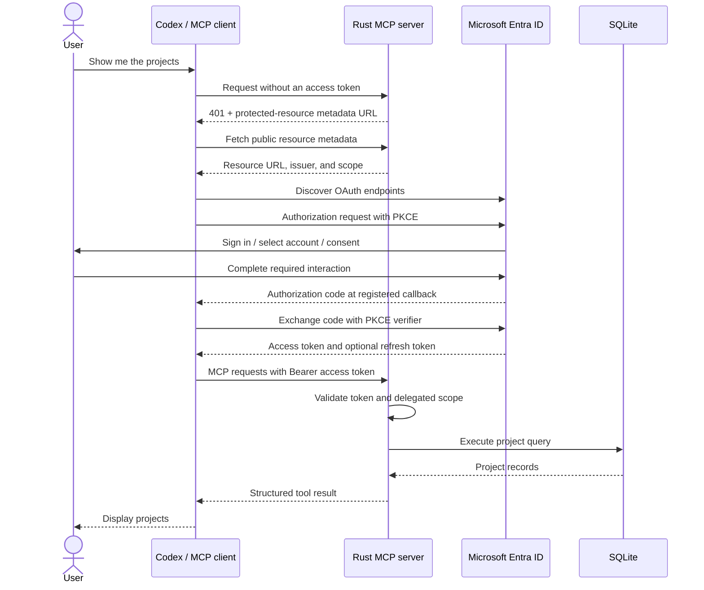

# Part 1: Handle Entra signing-key rotation without restarting the MCP server

> Replace `YOUR_GITHUB_OWNER/YOUR_REPOSITORY` in repository links and clone
> commands with the location of your public GitHub repository.

This guide provides starter code for an authenticated MCP service.
You will run an MCP server, register an API and a public client in Microsoft
Entra ID, connect Codex over Streamable HTTP, and query a small SQLite project
database after signing in.

The solution follows the [MCP authorization model](https://modelcontextprotocol.io/specification/2025-11-25/basic/authorization):
the client obtains an access token using Authorization Code with PKCE, and the
MCP server validates that token before accepting protected requests. Entra
handles sign-in and token issuance. The Rust application acts as the OAuth
resource server.

This guide builds the local development baseline and provides convenient
template code and structure so it can easily be expanded and adapted for 
your use case. The authentication configuration is designed to easily port
this application to a production hosting environment, not to be continuously
ran from your local machine. 

## What you will build

1. **Refresh periodically:** update cached keys before they become too old.
2. **Handle an unfamiliar `kid`:** perform a controlled refresh, then retry validation.
3. **Control concurrent refreshes:** share one refresh among waiting requests and apply a cooldown across unknown key IDs.
4. **Bound failure handling:** define how long previously fetched keys remain usable during an outage, and demonstrate rotation and failure behavior with tests.

## How authentication fits together

TODO: update the mermaid diagram to include any new parts we added from this guide in red.


## Before you start

1. Follow the guide in [Part 0: Build an OAuth 2.1-Protected HTTP MCP Server]()
2. Prosper

## 1. Refresh Periodically

We will start by setting `AuthState::new` to discover Entra's JWKS URL, registers it once with
`jwks_cache::Registry`, and fetch the initial keys before serving requests.
Instead of the old pattern AuthState which held a fixed `JwkSet` instead.

Add these dependencies to `Cargo.toml`, keeping the application's existing
Reqwest 0.13 dependency:

```toml
jwks-cache = "0.2.0"
# Enable system trust for jwks-cache's Reqwest 0.12 client via feature unification.
reqwest-jwks = { package = "reqwest", version = "0.12.28", default-features = false, features = ["rustls-tls-native-roots"] }
```

`jwks-cache` creates its own Reqwest 0.12 client, whose `rustls-tls` feature
uses bundled CA certificates. The renamed dependency enables
[system root certificates](https://docs.rs/reqwest/0.12.28/reqwest/#optional-features)
for that same client through
[Cargo feature unification](https://doc.rust-lang.org/cargo/reference/features.html#feature-unification).
This lets JWKS requests trust locally installed corporate CAs, including
trusted certificates in macOS Keychain, and avoids `InvalidCertificate(UnknownIssuer)`
when those certificates are needed. Certificate verification remains enabled.

```diff
-use jsonwebtoken::{Algorithm, DecodingKey, Validation, decode, decode_header, jwk::JwkSet};
+use jsonwebtoken::{Algorithm, DecodingKey, Validation, decode, decode_header, jwk::Jwk};
+use jwks_cache::{IdentityProviderRegistration, Registry};

 pub struct AuthState {
     pub(crate) config: AuthConfig,
-    keys: JwkSet,
+    registry: Registry,
     validation: Validation,
 }
```

```diff
-        // Demo: load keys once. Restart to refresh them after a signing-key rotation.
-        let keys = client
-            .get(discovery.jwks_uri)
-            .send()
-            .await?
-            .error_for_status()?
-            .json()
-            .await?;
-        Ok(Self::from_keys(config, keys))
+        let registry = Registry::new();
+        let registration = Self::key_registration(&config, &discovery.jwks_uri)?;
+        registry.register(registration).await?;
+        registry.resolve(&config.tenant_id, "entra", None).await?;
+        Ok(Self::from_registry(config, registry))
+    }
```

Next, add the key registration function which will take our AuthConfig and the jwks_uri
and return the result or our IdP registration. We also need to update the from_keys function
to match the new from_registry pattern

```diff
+    fn key_registration(
+        config: &AuthConfig,
+        jwks_uri: &str,
+    ) -> Result<IdentityProviderRegistration, jwks_cache::Error> {
+        let mut registration =
+            IdentityProviderRegistration::new(&config.tenant_id, "entra", jwks_uri)?;
+        registration.max_ttl = Duration::from_secs(60 * 60);
+        // Stay below the default 30-second minimum TTL, including jitter.
+        registration.refresh_early = Duration::from_secs(10);
+        Ok(registration)
     }

-    fn from_keys(config: AuthConfig, keys: JwkSet) -> Self {
+    fn from_registry(config: AuthConfig, registry: Registry) -> Self {
         let mut validation = Validation::new(Algorithm::RS256);
         validation.set_audience(&[&config.audience]);
         validation.set_issuer(&[config.issuer()]);
@@ -72,24 +82,54 @@ impl AuthState {
         validation.validate_nbf = true;
         Self {
             config,
-            keys,
+            registry,
             validation,
         }
     }
```

Next we can update our validation function to include a new verify_token_with_cache
claim that we will write in next.
```diff
~   async fn validate(&self, token: &str) -> Result<(), StatusCode> {
+        let claims = self.verify_token_with_cache(token).await?;
```

Finally, we can add our two new functions to handle refreshing the keys automatically
and verifying the token with the cache.

```rust
    pub async fn refresh_keys_periodically(self: Arc<Self>) {
        let mut interval = tokio::time::interval(Duration::from_secs(5));
        interval.set_missed_tick_behavior(tokio::time::MissedTickBehavior::Skip);
        loop {
            interval.tick().await;
            // resolve starts a background refresh only when the cache is due.
            // Polling also refreshes keys while no protected requests arrive.
            if let Err(error) = self
                .registry
                .resolve(&self.config.tenant_id, "entra", None)
                .await
            {
                tracing::warn!(%error, "Periodic JWKS cache check failed");
            }
        }
    }

    async fn verify_token_with_cache(&self, token: &str) -> Result<Claims, StatusCode> {
        let header = decode_header(token).map_err(|_| StatusCode::UNAUTHORIZED)?;
        if header.alg != Algorithm::RS256 {
            return Err(StatusCode::UNAUTHORIZED);
        }
        let kid = header.kid.ok_or(StatusCode::UNAUTHORIZED)?;
        let keys = self
            .registry
            .resolve(&self.config.tenant_id, "entra", Some(&kid))
            .await
            .map_err(|_| StatusCode::UNAUTHORIZED)?;
        let jwk = keys.find(&kid).ok_or(StatusCode::UNAUTHORIZED)?;
        // jwks-cache 0.2 uses jsonwebtoken 10; this application uses version 11.
        // Convert the selected public JWK between their distinct Rust types.
        let jwk: Jwk = serde_json::from_value(
            serde_json::to_value(jwk).map_err(|_| StatusCode::UNAUTHORIZED)?,
        )
        .map_err(|_| StatusCode::UNAUTHORIZED)?;
        let key = DecodingKey::from_jwk(&jwk).map_err(|_| StatusCode::UNAUTHORIZED)?;
        Ok(decode::<Claims>(token, &key, &self.validation)
            .map_err(|_| StatusCode::UNAUTHORIZED)?
            .claims)
    }

```

Token verification follows this path for every protected request:

```text
require_auth → validate(token).await → verify_token_with_cache(token).await
```

The helper uses `decode_header` to read the key ID, rejects algorithms other
than RS256, and calls `resolve(tenant_id, "entra", Some(&kid)).await` to get
the cached keys. It then verifies the signature using the existing issuer,
audience, expiry, and not-before validation settings. `validate` continues
checking the tenant, token version, and delegated scope. Reading the header
alone does not verify the token.

`main` starts a separate `refresh_keys_periodically` task.

```diff
+    let key_refresh = tokio::spawn(auth.refresh_keys_periodically());
~    let result = axum::serve(listener, app)
         .with_graceful_shutdown(async {
             let _ = tokio::signal::ctrl_c().await;
             tracing::info!("Shutting down MCP server");
         })
~        .await;
+    key_refresh.abort();
+    result?;
```

The effective cache lifetime follows the provider's HTTP caching headers,
with a 30-second minimum and a one-hour maximum. Refresh becomes due ten
seconds before expiry, with up to five seconds of additional early jitter.
The timer checks that deadline every five seconds.

`jwks-cache` 0.2 uses `jsonwebtoken` 10 internally. This application keeps
version 11 and converts the selected public JWK through Serde before calling
`DecodingKey::from_jwk`.

## 2. Handle an unfamiliar `kid`

## 3. Control concurrent refreshes

## 4. Bound failure handling

## Next steps

This guide is part of a four-part series on creating and publishing
a well-architected MCP server.

Previous guides:

- [Part 0: Build an OAuth 2.1-protected HTTP MCP server](https://github.com/YOUR_GITHUB_OWNER/YOUR_REPOSITORY/tree/main).

Continue with:

- [Part 2: Create identity-protected MCP tools](https://github.com/YOUR_GITHUB_OWNER/YOUR_REPOSITORY/tree/02-protected-tools).
- [Part 3: Create a long-running tool with streamed results](https://github.com/YOUR_GITHUB_OWNER/YOUR_REPOSITORY/tree/03-stream-tool).
