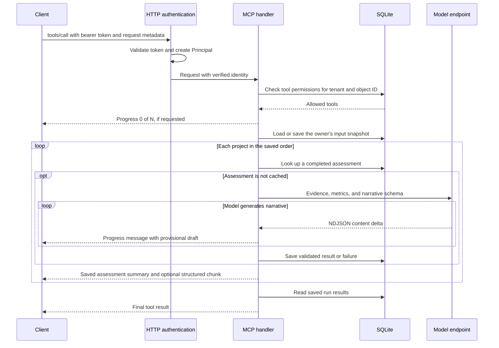

# Part 3: Create a long-running tool with streamed results

> Replace `YOUR_GITHUB_OWNER/YOUR_REPOSITORY` in repository links and clone
> commands with the location of your public GitHub repository.

[In Part 2](https://github.com/YOUR_GITHUB_OWNER/YOUR_REPOSITORY/tree/02-protected-tools),
you used the authenticated Entra identity to control which project tools a user
can discover and call. In this guide, you will add a portfolio health assessment
that performs asynchronous work and reports each project's result as it finishes.

## What you will build

One completed project assessment is the work unit. For each project, the server:

1. Loads evidence from a saved input snapshot.
2. Calculates spending variance and overdue milestone counts.
3. Streams an LLM's draft explanation and recommended actions through MCP progress.
4. Validates the response and saves the assessment in SQLite.
5. Emits the saved assessment's summary and advances progress.

The six existing project tools remain available under their existing permissions.
This guide adds two new tools:

| Tool | Arguments | Result |
| --- | --- | --- |
| `assess_projects` | `run_id`, `project_ids`, optional `project_id` | Completed assessments, failed units, and pending project IDs |
| `read_assessment_run` | `run_id` | The calling user's saved run results |

For example:

> Assess projects 1, 2, and 3 for spending pressure and overdue milestones.
> Use run ID portfolio-demo-001 and return each assessment as it finishes.

For live assistant replies, the client calls `assess_projects` separately for
each `project_id`, keeping the same run ID and full ordered `project_ids` list.
Each call returns after that project is saved. The assistant reports the outcome
before calling the next project, and keeps waiting if a tool call yields. These
ordinary tool results let the assistant continue without another user prompt.
Omitting `project_id` retains the original batch mode with one final response.

Each model request uses `stream: true`. The server reads Ollama's NDJSON stream
as it arrives and forwards provisional drafts through standard MCP progress
messages. It then validates and saves each complete assessment before announcing
completion. The optional structured chunk extension is
`mcp.streaming/project-assessments-v1`.

The demo uses the repository's [local plugin](plugin/README.md) in the ChatGPT
desktop app with local computer access. A fresh run generates new model output;
reusing a completed run returns cached assessments immediately. The desktop
host controls how progress messages are displayed. Progress notifications do
not guarantee an assistant reply while a batch call is running. The plugin's
assessment skill and server instructions describe the per-project call loop.

## How authentication and request context fit together

The client supplies a progress token in request metadata, and the server uses
that token for progress notifications until the request ends. This follows the
[MCP progress pattern](https://modelcontextprotocol.io/specification/2025-11-25/basic/utilities/progress).
The sequence below shows a batch call (`project_id` omitted) with this server's
authentication, authorization, and storage. Per-project calls use the same path
for one selected unit, then return the cumulative saved run:



The tool receives an RMCP `RequestContext<RoleServer>` alongside its arguments:

| Context value | Purpose |
| --- | --- |
| HTTP request extensions | Carry the verified `Principal` into the tool handler |
| `context.protocol_version()` | The version negotiated by the host; no assessment-specific version gate |
| `context.client_capabilities()` | Check whether the client accepts assessment chunks |
| `context.meta.get_progress_token()` | Associate progress with this active request |
| `context.peer` | Send progress notifications to the caller |
| `context.ct` | Stop work when the request is cancelled |

The server derives the run owner from the verified `(tenant_id, object_id)`;
the client does not supply an owner argument. Both assessment tools scope their
database queries to that owner. Tool permissions are checked again on each new
call, including retries and reads. An active run is authorized at entry; it does
not reload permissions between projects.

Request context lasts for the current call. The snapshot and results live in
SQLite, so a later call with the same identity can recover them. The LLM receives
project evidence and metrics; the caller's Entra token is not forwarded to it.

## Before you start

1. **Complete Part 2.** Keep its Entra registrations, delegated `access_as_user`
   scope, token validation, signing-key refresh, and database permissions.
2. **Use your existing local configuration.** Confirm `.env` contains your
   `ENTRA_TENANT_ID` and `ENTRA_API_CLIENT_ID`, with
   `MCP_RESOURCE=http://localhost:8001/mcp` and
   `DATABASE_URL=sqlite://data/demo.db`. For a fresh checkout, copy
   `.env.example` to `.env` and fill in your IDs. The
   [plugin setup guide](plugin/README.md) covers client configuration and
   installation; add the assessment configuration below before starting this
   version of the server.
3. **Have an Ollama-compatible endpoint ready.** The adapter uses the
   [Ollama chat API](https://docs.ollama.com/api/chat), including a JSON schema
   in `format` and streamed NDJSON records containing `message.content` and `done`.
   Configure an installed model that supports structured output.
4. **Run commands from the repository root.** You will need the Rust toolchain
   and the `sqlite3` CLI. Stop the running server before applying updates.
   This checkout contains the implementations described below; the source links
   show the complete code.

Add these settings to your existing `.env`:

```dotenv
LLM_URL=http://localhost:11434/api/chat
LLM_MODEL=your-installed-model

# Optional bearer credential for an authenticated compatible endpoint:
# LLM_API_KEY=...
```

Replace `your-installed-model` with a model available at your endpoint.
`LLM_MODEL` is required at startup. `LLM_URL` defaults to the local URL above,
and `LLM_API_KEY` is optional. The adapter allows five seconds to connect and
60 seconds for each model request.

## 1. Add assessment evidence and storage

[data/assessments.sql](data/assessments.sql) adds evidence tables and durable run
storage alongside the existing `projects` table:

| Table | Purpose |
| --- | --- |
| `project_spend` | Monthly planned and actual spending in USD cents |
| `project_milestones` | Due dates and optional completion dates |
| `project_updates` | Dated status reports used as narrative evidence |
| `assessment_runs` | Owner, run ID, analyzer settings, and the saved evidence snapshot |
| `assessment_units` | One saved result or failure per project in a run |

Keep your existing demo database. For a fresh database only, create the five
fictional projects from Part 2:

```sh
mkdir -p data
sqlite3 data/demo.db < data/seed.sql
```

`seed.sql` resets matching project IDs to their seed values. Skip it when
preserving existing project records.

Apply the assessment schema and seed its evidence:

```sh
sqlite3 data/demo.db < data/assessments.sql
sqlite3 data/demo.db < data/seed_assessments.sql
```

[data/seed_assessments.sql](data/seed_assessments.sql) adds 12 months of spending,
one milestone, and one status update for each existing project. Projects whose
IDs are divisible by three have higher spending, an overdue milestone, and a
supplier-delay update. With the five seed projects, project 3 illustrates this
case. Dates are relative to when you seed the database.

The evidence seed uses `INSERT OR IGNORE`, so rerunning it preserves existing
rows with matching keys. Startup also creates missing assessment tables, but
does not seed evidence or grant permissions.

## 2. Build a repeatable assessment

[src/assessments.rs](src/assessments.rs) handles evidence capture, model requests,
validation, and persistence. Its `Analyst` shares an HTTP client and a semaphore
across server clones.

### Capture the inputs once

`Analyst::snapshot` opens a transaction and captures a single `as_of` date for
the run. Each project's evidence contains:

- The project record.
- Up to 12 monthly spending records from the current month and previous 11 months.
- Up to 100 milestones overdue as of the snapshot date.
- The latest five status updates reported on or before that date.

The server rejects evidence exceeding the spending or milestone limits and
rejects a serialized snapshot larger than 1 MB. It saves the snapshot before
calling the model.

A run is identified by its owner and `run_id`. Reusing that run ID requires
the same ordered project IDs, analysis version, model, and endpoint URL. A
matching retry reads the saved snapshot, even if project data has since changed.
Use a new run ID to assess fresh evidence.

### Calculate metrics before inference

Rust calculates these values from the snapshot:

```rust
let planned_minor = input.spend.iter().map(|s| s.planned_minor).sum::<i64>();
let actual_minor = input.spend.iter().map(|s| s.actual_minor).sum::<i64>();

let metrics = Metrics {
    currency: "USD".into(),
    planned_minor,
    actual_minor,
    variance_minor: actual_minor - planned_minor,
    overdue_count: input.overdue.len(),
};
```

A positive `variance_minor` means actual spending exceeds planned spending for
the captured periods. The existing project's `budget` has no defined currency,
and `risk_score` has no defined scale. The prompt tells the model to preserve
those distinctions when interpreting the evidence.

### Validate and save the explanation

`Analyst::assess` makes one asynchronous model request for each uncached project.
It sends the evidence, calculated metrics, allowed evidence IDs, and the
`Narrative` JSON schema. Evidence IDs use forms such as `project:3`,
`spend:2026-11-01`, `milestone:10003`, and `update:20003`.

The request sets `stream: true`. The adapter decodes complete NDJSON records
across arbitrary HTTP chunk and UTF-8 boundaries, accumulates `message.content`,
and forwards content deltas through a bounded channel. MCP draft updates are
limited to ten per second. These drafts contain partial JSON and have not yet
passed narrative validation. The terminal `done: true` record supplies optional
token counts. A truncated stream, generation error, or `done_reason: "length"`
fails the unit. The stream is limited to 2 MB on the wire and 128 KB of content.

The response must contain a nonempty summary, 1–20 valid evidence references,
and at most five actions. The adapter also checks response size, field lengths,
unexpected narrative fields, and whether generation completed. Invalid output
becomes a saved unit failure.

Completed assessments include the run/project `unit_id`, analysis version
`portfolio-health-v1`, model, metrics, narrative, and optional token counts.
`save` preserves completed results; a retry can replace an earlier failure with
a successful assessment. `cached` reuses completed results, and `read` returns
the run's `completed`, `failed`, and `pending_project_ids` collections.

## 3. Connect the streaming tools

Keep both new methods inside the existing `#[tool_router] impl McpServer` in
[src/tools.rs](src/tools.rs), so they are registered alongside the six project
tools. `assess_projects` validates a 1–64 character run ID containing ASCII
letters, digits, hyphens, or underscores, plus 1–20 distinct positive project IDs.

The optional `project_id` must belong to `project_ids`. When supplied, the tool
captures or reuses the full run snapshot, processes only that project, and
returns the cumulative saved run with the other projects still pending.
Changing only `project_id` does not change the run's inputs. This is the preferred
chat workflow: the assistant can report a real result before requesting the
next project. Repeating a completed selection uses its saved assessment;
selecting a failed project retries only that unit.

When `project_id` is omitted, the tool processes the full batch sequentially in
the supplied order. For each unit, it loads a cached result or streams a new
model draft, saves the outcome, and then sends its completed summary. A model
failure is reported while the batch continues with the next project. Snapshot,
storage, or notification-delivery errors end the call.

The shared semaphore permits one active assessment run per server process. A
second run receives a tool error asking the caller to retry later. Each run has
a 180-second deadline and watches `context.ct` for cancellation. Completed units
remain saved when a request ends; unfinished work requires another call.

### Make progress and chunks optional

`assessment_progress` returns immediately when there is no `progressToken`.
Otherwise, it sends `notifications/progress` with increasing progress, total,
and a message. Progress starts at zero, uses a bounded increasing fraction
within each project while drafts arrive, and reaches the next integer when
that project succeeds or fails. A selected-project call uses total 1 and progress
from 0 to 1, while structured chunk sequences retain the full run's order.
The fraction indicates activity, not an estimate
of remaining generation time. Ordinary messages include draft text and completed
summaries with actions, so they do not depend on a custom extension.

Clients that declare `mcp.streaming/project-assessments-v1` also receive a unit
payload in the notification's `_meta` under that same key. The payload
contains `runId`, a one-based project `sequence`, and `status`. Draft chunks
include `projectId` and accumulated partial JSON in `text`; completed chunks
include `result`; failed chunks include `projectId` and `error`.

The extension is specific to this demo and is optional for the desktop workflow.
The final tool result contains the saved run results regardless of whether the
client requested progress or chunks.

### Wire the analyst into the server

The integration changes are spread across four files:

| File | Update |
| --- | --- |
| [Cargo.toml](Cargo.toml) | Enable Tokio's `sync` feature for the shared semaphore |
| [src/mcp.rs](src/mcp.rs) | Store the shared analyst, expose `principal_from_context`, and advertise the chunk extension in `get_info` |
| [src/handlers.rs](src/handlers.rs) | Accept the analyst and transport configuration, then call `McpServer::new(pool).with_analyst(analyst)` |
| [src/main.rs](src/main.rs) | Declare the assessment module, apply its schema, create the analyst and transport, and cancel transport work during shutdown |

After creating the pool, `main` initializes the shared dependencies:

```rust
sqlx::raw_sql(include_str!("../data/assessments.sql"))
    .execute(&pool)
    .await?;

let analyst = Arc::new(assessments::Analyst::from_env()?);
let transport = rmcp::transport::streamable_http_server::StreamableHttpServerConfig::default();
let shutdown = transport.cancellation_token.clone();

let app = router(pool, auth.clone(), analyst, transport);
```

The graceful-shutdown closure uses `async move` and calls `shutdown.cancel()`
after receiving Ctrl+C. This lets the transport stop active streams and propagate
cancellation to the request handlers.

## 4. Grant access and start the server

Apply the Part 2 authorization schema if needed:

```sh
sqlite3 data/demo.db < data/authorization.sql
```

The script grants the original six tools. Add the assessment grants explicitly:

```sh
sqlite3 data/demo.db <<'SQL'
INSERT OR IGNORE INTO role_tools (role, tool_name) VALUES
    ('worker', 'assess_projects'),
    ('worker', 'read_assessment_run');
SQL
```

Keep your existing real user assignments. For a fresh setup, replace the
placeholders below with your verified Entra tenant ID and user Object ID:

```sql
INSERT OR IGNORE INTO user_roles (tenant_id, object_id, role)
VALUES ('YOUR_TENANT_ID', 'YOUR_USER_OBJECT_ID', 'worker');
```

The placeholder assignments in `authorization.sql` do not grant access to a real
account. With the grants above, a `worker` can discover all eight tools; a
`reporter` retains the three project read tools. Reading an assessment also
requires ownership of that run.

Check and start the server:

```sh
cargo check --locked
cargo test --locked
cargo run --locked
```

Startup needs outbound HTTPS access for Entra discovery and signing keys.
Leave the model endpoint and server running while exercising the tools.

## 5. Demonstrate incremental results in the ChatGPT desktop app

Use the existing **OAuth HTTP MCP** local plugin from this repository. Follow
[its installation and sign-in instructions](plugin/README.md), reinstall version
`0.1.7`, and refresh the server's tools after rebuilding. Restart the desktop app
and open a new conversation with local computer access so the local MCP endpoint
is reachable. Select **OAuth HTTP MCP** in the composer. The server exposes all
eight tools to a `worker` with the assessment grants above.

### Recover a run in the same conversation

Stop the active request after a project finishes, then ask:

```text
Read the saved results for the assessment run we just started.
```

To continue it, ask:

```text
Resume that assessment run with the same run ID and projects 1, 2, and 3
in the same order. Reuse completed assessments and retry unfinished projects.
```

The first prompt calls `read_assessment_run`; the second calls `assess_projects`
again. Completed units remain in SQLite and return immediately without new
inference. Pending or failed units are generated again. To demonstrate fresh
streaming a second time, request a new run ID. Changing the project order, model,
endpoint URL, or analysis version for an existing run ID returns an input-mismatch
error. Another user cannot read the run even if they know its ID.

### Check common failures

| Symptom | Check |
| --- | --- |
| Assessment tools are missing | Apply their `role_tools` grants, verify the signed-in user's role, and refresh discovery |
| Startup reports a missing environment variable | Set `LLM_MODEL` as well as the existing Entra settings |
| Assessments return instantly | Choose a new run ID; completed runs are cached |
| Only one batch result appears | Refresh tools and plugin `0.1.7`; use `project_id` on each call and report each outcome before the next call |
| Assistant says the call is still running and stops | It must wait on the host's running handle and continue in the same turn; progress notifications cannot restart a finished turn |
| Draft progress is hidden | Check host progress-token support and how the desktop build renders progress messages |
| Progress is visible but no structured chunks arrive | The host must also advertise `mcp.streaming/project-assessments-v1`; ordinary messages need no extension |
| Model request or validation failures | Check `LLM_URL`, the installed model, credentials, and the server's stage-specific warning |
| A run is already active | Wait for it to end, then retry; the concurrency limit is shared by the process |

## Series

This is the final installment of a four-part series on creating and publishing
a well-architected MCP server.

Previous guides:

- [Part 0: Build an OAuth 2.1-protected HTTP MCP server](https://github.com/YOUR_GITHUB_OWNER/YOUR_REPOSITORY/tree/main).
- [Part 1: Handle Entra signing-key rotation without restarting the MCP server](https://github.com/YOUR_GITHUB_OWNER/YOUR_REPOSITORY/tree/01-harden-auth).
- [Part 2: Create identity-protected MCP tools](https://github.com/YOUR_GITHUB_OWNER/YOUR_REPOSITORY/tree/02-protected-tools).
