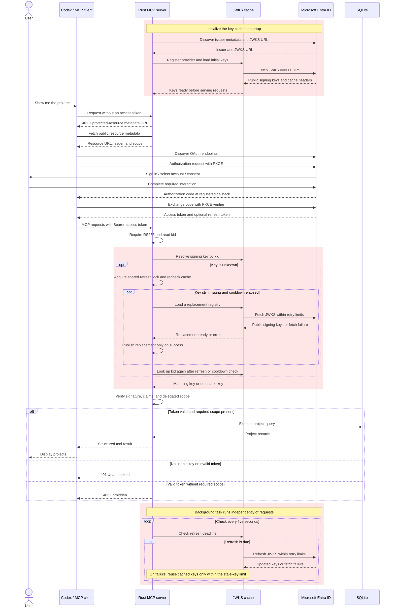

# Part 1: Handle Entra signing-key rotation without restarting the MCP server

> Replace `YOUR_GITHUB_OWNER/YOUR_REPOSITORY` in repository links and clone
> commands with the location of your public GitHub repository.

In Part 0, you built a Rust MCP server protected by Microsoft Entra ID,
connected Codex over Streamable HTTP, and queried a small SQLite project
database after signing in. That baseline loads Entra's public signing keys
once at startup. When Entra rotates its signing keys, tokens signed with a
new key can fail validation until the server restarts.

This guide extends that server to handle signing-key rotation automatically
using `jwks-cache`. You will refresh cached keys periodically, refresh and
retry validation when a token references an unfamiliar key ID (`kid`),
coordinate concurrent refreshes, and bound retries and stale-key use during
an outage.

The service continues to follow the [MCP authorization model](https://modelcontextprotocol.io/specification/2025-11-25/basic/authorization):
the client obtains an access token using Authorization Code with PKCE, Entra
handles sign-in and token issuance, and the Rust application validates tokens
as the OAuth resource server before accepting protected requests.

The examples run locally and build on the existing application structure,
providing a foundation you can adapt to your use case and extend for a
production hosting environment.

## What you will build

1. **Refresh periodically:** update cached keys before they become too old.
2. **Handle an unfamiliar `kid`:** perform a controlled refresh, then retry validation.
3. **Control concurrent refreshes:** share one refresh among waiting requests and apply a cooldown across unknown key IDs.
4. **Bound failure handling:** define how long previously fetched keys remain usable during an outage, and demonstrate rotation and failure behavior with tests.

## How authentication fits together

Entra continues to handle sign-in and token issuance. The MCP server uses
Entra's public JSON Web Key Set (JWKS) to verify access-token signatures,
then checks the token's claims and delegated scope before running a tool.

The red shaded blocks show the key-cache and refresh behavior introduced in
this guide. The server loads keys before accepting requests, refreshes them
in a background task, and performs a controlled refresh when a token's
`kid` is unfamiliar. Concurrent requests share the unknown-key refresh, and
a cooldown limits repeated attempts across different unknown key IDs.



Reading `kid` selects a candidate key; signature and claim validation still
determine whether the token is accepted. The client and Entra continue to
handle access-token renewal. The retry and stale-key
limits described below bound how the cache handles an unavailable JWKS
endpoint.

## Before you start

1. **Complete Part 0: Build an OAuth 2.1-Protected HTTP MCP Server.**
   Start with its working Rust server, Rust and Cargo toolchain, SQLite
   tooling, and seeded project database. The changes below build on that
   application's existing authentication code.
2. **Keep the Entra registrations from Part 0.** You need the API
   registration configured for v2 access tokens and the delegated
   `access_as_user` scope, plus the public client registration with its
   redirect URI, API permission, and any required consent.
3. **Check your local configuration.** Your `.env` should contain
   `ENTRA_TENANT_ID`, `ENTRA_API_CLIENT_ID`, `MCP_RESOURCE`, and a working
   `DATABASE_URL`. Keep the resource URL, client connection URL, and requested
   scope consistent. See [.env.example](.env.example) and the
   [local plugin configuration instructions](plugin/README.md#configure-your-own-registrations).
4. **Verify the baseline connection.** Run `cargo run`, connect Codex using
   your existing client configuration, sign in, and confirm that
   `Show me the projects` returns records. Resolve any registration,
   configuration, or database errors before changing key handling.

## 1. Refresh periodically

Start by updating `AuthState::new` to discover Entra's JWKS URL, register the
provider once with `jwks_cache::Registry`, and fetch the initial keys before
serving requests. This replaces the fixed `JwkSet` previously stored in
`AuthState`.

### Configure the cache

Add these dependencies to `Cargo.toml`, keeping the application's existing
Reqwest 0.13 dependency:

```toml
jwks-cache = "0.2.0"
reqwest-jwks = { package = "reqwest", version = "0.12.28", default-features = false, features = ["rustls-tls-native-roots"] }
```

`jwks-cache` creates its own Reqwest 0.12 client, whose `rustls-tls` feature
uses bundled CA certificates. The renamed dependency enables
[system root certificates](https://docs.rs/reqwest/0.12.28/reqwest/#optional-features)
for that same client through
[Cargo feature unification](https://doc.rust-lang.org/cargo/reference/features.html#feature-unification).
This allows JWKS requests to trust locally installed corporate CAs,
including trusted certificates in macOS Keychain, and avoids
`InvalidCertificate(UnknownIssuer)` when those certificates are needed.
Certificate verification remains enabled.

Update the imports and replace the `keys` field in `AuthState` with a
`Registry`:

```diff
-use jsonwebtoken::{Algorithm, DecodingKey, Validation, decode, decode_header, jwk::JwkSet};
+use jsonwebtoken::{Algorithm, DecodingKey, Validation, decode, decode_header, jwk::Jwk};
+use jwks_cache::{IdentityProviderRegistration, Registry};

 pub struct AuthState {
     pub(crate) config: AuthConfig,
-    keys: JwkSet,
+    registry: Registry,
     validation: Validation,
 }
```

Then update `AuthState::new` to register the provider and load the initial
keys:

```diff
-        // Demo: load keys once. Restart to refresh them after a signing-key rotation.
-        let keys = client
-            .get(discovery.jwks_uri)
-            .send()
-            .await?
-            .error_for_status()?
-            .json()
-            .await?;
-        Ok(Self::from_keys(config, keys))
+        let registry = Registry::new();
+        let registration = Self::key_registration(&config, &discovery.jwks_uri)?;
+        registry.register(registration).await?;
+        registry.resolve(&config.tenant_id, "entra", None).await?;
+        Ok(Self::from_registry(config, registry))
+    }
```

Next, add `key_registration`, which accepts an `AuthConfig` and a JWKS URL
and returns an `IdentityProviderRegistration`. Rename `from_keys` to
`from_registry` and update it to store the registry:

```diff
+    fn key_registration(
+        config: &AuthConfig,
+        jwks_uri: &str,
+    ) -> Result<IdentityProviderRegistration, jwks_cache::Error> {
+        let mut registration =
+            IdentityProviderRegistration::new(&config.tenant_id, "entra", jwks_uri)?;
+        registration.max_ttl = Duration::from_secs(60 * 60);
+        // Stay below the default 30-second minimum TTL, including jitter.
+        registration.refresh_early = Duration::from_secs(10);
+        Ok(registration)
     }

-    fn from_keys(config: AuthConfig, keys: JwkSet) -> Self {
+    fn from_registry(config: AuthConfig, registry: Registry) -> Self {
         let mut validation = Validation::new(Algorithm::RS256);
         validation.set_audience(&[&config.audience]);
         validation.set_issuer(&[config.issuer()]);
@@ -72,24 +82,54 @@ impl AuthState {
         validation.validate_nbf = true;
         Self {
             config,
-            keys,
+            registry,
             validation,
         }
     }
```

### Update token validation

Update `validate` to obtain claims from the `verify_token_with_cache` helper,
which you will add next:

```diff
~   async fn validate(&self, token: &str) -> Result<(), StatusCode> {
+        let claims = self.verify_token_with_cache(token).await?;
```

Add `refresh_keys_periodically` to refresh the keys automatically and
`verify_token_with_cache` to verify tokens using the cached keys:

```rust
pub async fn refresh_keys_periodically(self: Arc<Self>) {
    let mut interval = tokio::time::interval(Duration::from_secs(5));
    interval.set_missed_tick_behavior(tokio::time::MissedTickBehavior::Skip);
    loop {
        interval.tick().await;
        // resolve starts a background refresh only when the cache is due.
        // Polling also refreshes keys while no protected requests arrive.
        if let Err(error) = self
            .registry
            .resolve(&self.config.tenant_id, "entra", None)
            .await
        {
            tracing::warn!(%error, "Periodic JWKS cache check failed");
        }
    }
}

async fn verify_token_with_cache(&self, token: &str) -> Result<Claims, StatusCode> {
    let header = decode_header(token).map_err(|_| StatusCode::UNAUTHORIZED)?;
    if header.alg != Algorithm::RS256 {
        return Err(StatusCode::UNAUTHORIZED);
    }
    let kid = header.kid.ok_or(StatusCode::UNAUTHORIZED)?;
    let keys = self
        .registry
        .resolve(&self.config.tenant_id, "entra", Some(&kid))
        .await
        .map_err(|_| StatusCode::UNAUTHORIZED)?;
    let jwk = keys.find(&kid).ok_or(StatusCode::UNAUTHORIZED)?;
    // jwks-cache 0.2 uses jsonwebtoken 10; this application uses version 11.
    // Convert the selected public JWK between their distinct Rust types.
    let jwk: Jwk = serde_json::from_value(
        serde_json::to_value(jwk).map_err(|_| StatusCode::UNAUTHORIZED)?,
    )
    .map_err(|_| StatusCode::UNAUTHORIZED)?;
    let key = DecodingKey::from_jwk(&jwk).map_err(|_| StatusCode::UNAUTHORIZED)?;
    Ok(decode::<Claims>(token, &key, &self.validation)
        .map_err(|_| StatusCode::UNAUTHORIZED)?
        .claims)
}
```

Token verification follows this path for every protected request:

```text
require_auth → validate(token).await → verify_token_with_cache(token).await
```

The helper uses `decode_header` to read the key ID, rejects algorithms other
than RS256, and calls `resolve(tenant_id, "entra", Some(&kid)).await` to get
the cached keys. It then verifies the signature using the existing issuer,
audience, expiry, and not-before validation settings. `validate` continues
checking the tenant, token version, and delegated scope. Reading the header
alone does not verify the token.

### Start the refresh task

In `main`, start `refresh_keys_periodically` as a background task and stop it
when the server shuts down:

```diff
+    let key_refresh = tokio::spawn(auth.refresh_keys_periodically());
~    let result = axum::serve(listener, app)
         .with_graceful_shutdown(async {
             let _ = tokio::signal::ctrl_c().await;
             tracing::info!("Shutting down MCP server");
         })
~        .await;
+    key_refresh.abort();
+    result?;
```

The effective cache lifetime follows the provider's HTTP caching headers,
with a 30-second minimum and a one-hour maximum. Refresh becomes due ten
seconds before expiry, with up to five seconds of additional early jitter.
The timer checks that deadline every five seconds.

`jwks-cache` 0.2 uses `jsonwebtoken` 10 internally. This application keeps
version 11 and converts the selected public JWK through Serde before calling
`DecodingKey::from_jwk`.

## 2. Handle an unfamiliar `kid`

To handle a signing-key rotation, the application must fetch the new keys
and retry validation. `verify_token_with_cache` calls `resolve` with the
token's key ID. The registry handles refreshes when the cache is due; the
additional logic below handles unfamiliar key IDs. Refreshes are serialized
per tenant/provider so that concurrent requests can share the result.

### Share the registry and refresh state

Update `AuthState` with the following fields:

- `registry`: Change `Registry` to `Arc<RwLock<Registry>>` so tasks can share
  the registry, with concurrent reads and exclusive writes.
- `registration`: Store an `IdentityProviderRegistration` containing the
  Entra provider configuration and JWKS URL so it can be reused for refreshes.
- `unknown_key_refresh`: Add an `Arc<Mutex<Option<Instant>>>` to track the
  last unknown-key refresh attempt and enforce a cooldown.

If a key remains unknown during the cooldown, token validation fails without
starting another refresh.

```diff
 pub struct AuthState {
     pub(crate) config: AuthConfig,
-    registry: Registry,
+    registry: Arc<RwLock<Registry>>,
+    registration: IdentityProviderRegistration,
+    unknown_key_refresh: Arc<Mutex<Option<Instant>>>,
     validation: Validation,
 }
```

Update `from_registry` to initialize the new fields using the provider
registration returned by `key_registration`. Also update
`refresh_keys_periodically` to read and clone the registry through the
`RwLock` before resolving keys.

### Refresh and retry token validation

Update `verify_token_with_cache` to check for an unfamiliar key ID, call the
controlled refresh helper, and look up the key again before validating the
token:

```diff
     async fn verify_token_with_cache(&self, token: &str) -> Result<Claims, StatusCode> {
         let header = decode_header(token).map_err(|_| StatusCode::UNAUTHORIZED)?;
         if header.alg != Algorithm::RS256 {
             return Err(StatusCode::UNAUTHORIZED);
         }
         let kid = header.kid.ok_or(StatusCode::UNAUTHORIZED)?;
-        let keys = self
-            .registry
+        let registry = self.registry.read().await.clone();
+        let mut keys = registry
             .resolve(&self.config.tenant_id, "entra", Some(&kid))
             .await
             .map_err(|_| StatusCode::UNAUTHORIZED)?;
+        if keys.find(&kid).is_none() {
+            self.refresh_keys_for_unknown_kid(&kid)
+                .await
+                .map_err(|error| {
+                    tracing::warn!(%error, "Unknown signing key JWKS refresh failed");
+                    StatusCode::UNAUTHORIZED
+                })?;
+            let registry = self.registry.read().await.clone();
+            keys = registry
+                .resolve(&self.config.tenant_id, "entra", Some(&kid))
+                .await
+                .map_err(|_| StatusCode::UNAUTHORIZED)?;
+        }
```

### Add the controlled refresh helper

Finally, add `refresh_keys_for_unknown_kid` to the `AuthState` implementation.
The helper rechecks the cache while holding the shared refresh lock,
enforces the cooldown, and replaces the registry only after the new keys
have loaded successfully:

```rust
async fn refresh_keys_for_unknown_kid(&self, kid: &str) -> Result<(), jwks_cache::Error> {
    // One lock and timestamp per provider, shared even by AuthState clones.
    // Waiters recheck the cache after the in-flight refresh completes.
    let mut last_attempt = self.unknown_key_refresh.lock().await;
    let registry = self.registry.read().await.clone();
    let keys = registry
        .resolve(&self.config.tenant_id, "entra", Some(kid))
        .await?;
    if keys.find(kid).is_some() {
        return Ok(());
    }
    if last_attempt.is_some_and(|last| last.elapsed() < Duration::from_mins(5)) {
        return Ok(());
    }
    // Failed or cancelled refreshes also consume the cooldown.
    *last_attempt = Some(Instant::now());

    // jwks-cache 0.2's refresh() only refreshes entries that are already due.
    // Load a replacement first so a failed fetch preserves the active cache.
    let replacement = Registry::builder()
        .require_https(self.registration.require_https)
        .build();
    replacement.register(self.registration.clone()).await?;
    replacement
        .resolve(&self.config.tenant_id, "entra", None)
        .await?;
    *self.registry.write().await = replacement;
    Ok(())
}
```

## 3. Control concurrent refreshes

`jwks-cache` 0.2.0 already provides the cache concurrency controls needed for
this application. Each registered tenant/provider pair has its own cache
manager, which coordinates requests and background refreshes:

- **Serialize fetches:** A per-provider lock allows one fetch sequence at a
  time within that cache manager.
- **Suppress duplicate background refreshes:** Once a scheduled refresh is
  running, other requests and timer checks do not schedule another copy.
- **Continue serving fresh cached keys:** Requests can use the current key
  set while a background refresh fetches updated keys.

Section 2's shared lock and five-minute cooldown coordinate the explicit
unknown-key refreshes that create replacement registries. The crate handles
fetch concurrency within each registry, while that helper coordinates the
application's replacement attempts. Together, these controls are sufficient
for this guide.

For different scheduling requirements, the
[`IdentityProviderRegistration` documentation](https://docs.rs/jwks-cache/0.2.0/jwks_cache/struct.IdentityProviderRegistration.html)
describes `refresh_early` and `prefetch_jitter`. For deeper changes, see the
[`Registry` API](https://docs.rs/jwks-cache/0.2.0/jwks_cache/struct.Registry.html)
and the
[`CacheManager` documentation](https://docs.rs/jwks-cache/0.2.0/jwks_cache/cache/manager/struct.CacheManager.html),
which covers the per-provider cache and refresh lifecycle.

## 4. Bound failure handling

The crate also supplies bounded retries and a limited window for using
cached keys when the JWKS endpoint is unavailable. These defaults are
sufficient for this application, so `key_registration` leaves
`retry_policy` and `stale_while_error` unchanged.

The defaults in `jwks-cache` 0.2.0 are:

| Setting | Default | Effect |
| --- | --- | --- |
| `retry_policy.max_retries` | `2` | At most three HTTP attempts, including the initial request. |
| `retry_policy.attempt_timeout` | `3` seconds | Limits each HTTP attempt, shortened if less retry budget remains. |
| `retry_policy.deadline` | `8` seconds | Bounds the fetch sequence, including attempts and retry delays. |
| `retry_policy.initial_backoff` | `250` milliseconds | Starting delay between failed attempts. |
| `retry_policy.max_backoff` | `2` seconds | Caps exponential backoff; the default policy adds randomized jitter. |
| `stale_while_error` | `60` seconds | Allows previously fetched keys to remain usable after cache expiry when refreshes fail. |

The eight-second budget starts after the crate acquires its fetch lock.
Time spent waiting for that lock or Section 2's unknown-key refresh lock is
outside the budget, so it is not an eight-second limit on the whole MCP
request.

During an outage, stale fallback can help only when the cached set contains
the token's signing key. Signature, expiry, issuer, audience, tenant, and
scope checks still apply. Once the stale-key window ends, the registry must
fetch keys successfully before serving them again. An initial fetch failure
prevents server startup; a request that cannot obtain a usable signing key
receives `401 Unauthorized` through the existing authentication middleware.

To customize these limits, set `registration.retry_policy` and
`registration.stale_while_error` in `key_registration` before registering
the provider. See the
[`RetryPolicy` API](https://docs.rs/jwks-cache/0.2.0/jwks_cache/struct.RetryPolicy.html)
for attempt, timeout, backoff, deadline, and jitter options, and
[`IdentityProviderRegistration`](https://docs.rs/jwks-cache/0.2.0/jwks_cache/struct.IdentityProviderRegistration.html#structfield.stale_while_error)
for the stale-key window. The
[crate configuration guide](https://docs.rs/crate/jwks-cache/0.2.0#registry-configuration)
provides an overview of the available settings.

## Next steps

This guide is part of a four-part series on creating and publishing
a well-architected MCP server.

Previous guides:

- [Part 0: Build an OAuth 2.1-protected HTTP MCP server](https://github.com/YOUR_GITHUB_OWNER/YOUR_REPOSITORY/tree/main).

Continue with:

- [Part 2: Create identity-protected MCP tools](https://github.com/YOUR_GITHUB_OWNER/YOUR_REPOSITORY/tree/02-protected-tools).
- [Part 3: Create a long-running tool with streamed results](https://github.com/YOUR_GITHUB_OWNER/YOUR_REPOSITORY/tree/03-stream-tool).
